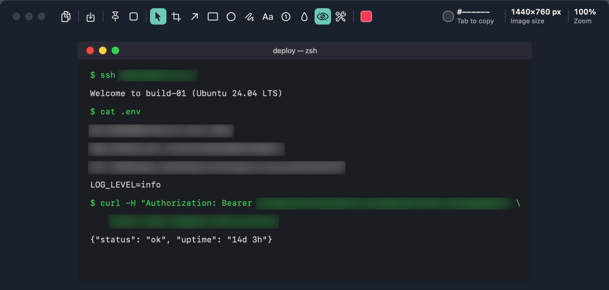
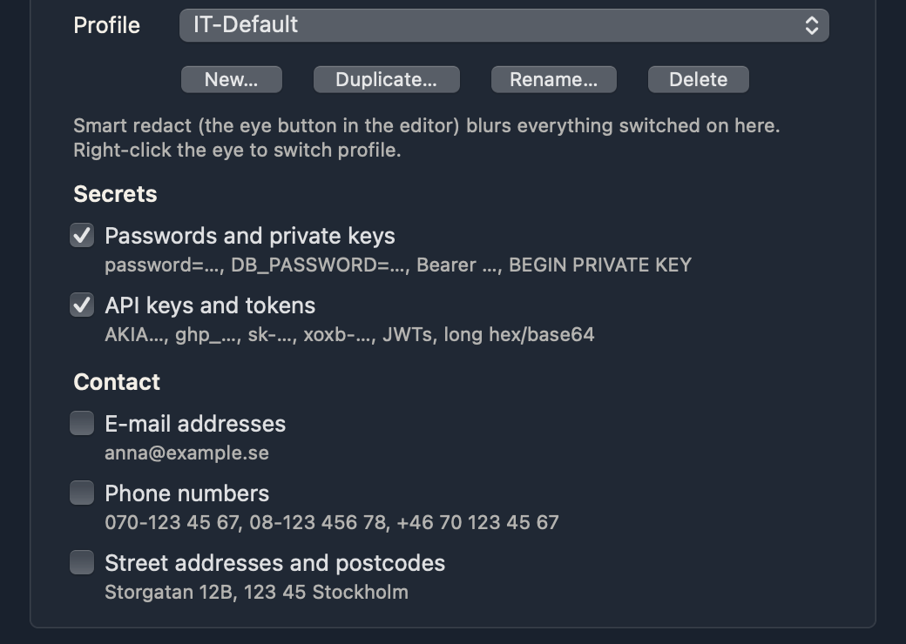

<picture>
  <source media="(prefers-color-scheme: dark)" srcset="docs/images/huglab-logo-readme-dark.png">
  
</picture>

# TrickShot

A screenshot tool for macOS. You can capture, annotate, blur what is sensitive and save it with a tag, all on your own Mac.

[**Download**](https://github.com/huglab-dev/TrickShot-app/releases/latest) · macOS 14 or later · Apple Silicon and Intel

 

TrickShot lives in the menu bar. Every capture opens in its own editor window, so several screenshots can be open at once. It was made for developer and IT work: screenshots of terminals, consoles and admin pages that have to be shared without passwords, keys or customer data in them.

## Capture

| Action | Default shortcut |
|---|---|
| Capture Area | ⌥⇧1 |
| Capture Window | ⌥⇧2 |
| Capture Full Screen | ⌥⇧3 |
| Copy Text (OCR) | ⌥⇧4 |
| Capture Scrolling Area | ⌥⇧5 |

All shortcuts can be changed in Settings.

- **Area** freezes the screen while you select an area, so menus and tooltips stay in the picture. A loupe shows pixel coordinates and the color under the pointer. The arrow keys move the pointer one pixel at a time, and `C` copies the color as hex.
- **Window** captures one window with clean edges, even when other windows cover it. Press Space during an area capture to switch to window mode.
- **Scrolling Area** keeps capturing while you scroll and stitches the frames into one tall picture. Sticky headers and footers are kept only once.
- **Copy Text** reads the text in an area and puts it on the clipboard without opening an editor.

You can also open your own pictures in the editor, from Finder, from the menu or from the clipboard.

## Edit

The tools are Arrow, Line, Box, Ellipse, Pen, Highlighter, Text, Step number, Blur (soft or pixelated), Spotlight, Magnifier, Crop, Cut out strip and Extract text. Every tool has a one-key shortcut. Shapes stay movable and editable, and every change can be undone.

**Cut out strip** removes a horizontal or vertical band and joins the rest, which is useful for hiding the middle of a long log. **Pin to screen** keeps a screenshot floating above other windows while you work.

## Smart redact

  

The eye button reads the text in the screenshot and blurs everything that matches the active profile. You can check the result and remove or add blur boxes yourself.

- **Secrets:** passwords and private keys, API keys and tokens (AWS, GitHub, Slack, OpenAI, JWTs and long hex or base64 strings), IP and MAC addresses, links and domain names.
- **Personal and company data:** e-mail addresses, phone numbers, street addresses, Swedish personnummer and organisationsnummer, card numbers, IBAN, bankgiro and plusgiro.
- **Your own lists:** words and regular expressions, such as customer names or ticket numbers.

Profiles hold different combinations, for example one for internal IT and one for sharing outside the company. Blur is burned into the exported file, so it cannot be undone or read back by the person who gets it.

## Save and share

- `⌘C` copies the finished picture, and `⌘S` saves it as a PNG.
- When you save, you can pick a tag that becomes the start of the file name, for example `acme_2026-11-09_22-01-33.png`. A script that sorts files can then route each screenshot to the right folder.
- Recent screenshots stay editable from the menu, with their annotations, for as long as your retention setting keeps them.

## Install

1. Download **TrickShot-x.y.z.dmg** from [Releases](https://github.com/huglab-dev/TrickShot-app/releases/latest), open it and drag **TrickShot** to **Applications**.
2. Open TrickShot. macOS blocks it the first time, because the app is signed with a self-signed certificate and is not notarized by Apple. Close the warning.
3. Open **System Settings → Privacy & Security**, scroll to **Security** and choose **Open Anyway** next to TrickShot.
4. When TrickShot asks for **Screen & System Audio Recording**, allow it in System Settings. Then quit TrickShot and open it again.

New versions need the same approval. Each Release also has a `.sha256` file, so you can check the download with `shasum -a 256 TrickShot-x.y.z.dmg`.

## Privacy

TrickShot works entirely on your Mac. It has no account, no analytics and no network connections. Text recognition uses Apple's on-device Vision framework. Screenshots are kept in `~/Library/Application Support/TrickShot` for the period you choose in Settings, and you can turn that off.

TrickShot needs the **Screen Recording** permission to take screenshots. It does not record video or audio.

## About

TrickShot is developed by Hugo Bjurström at [huglab](https://github.com/huglab-dev). It is free to download. The source code is not public.

TrickShot is an independent project and is not affiliated with or endorsed by Apple.
